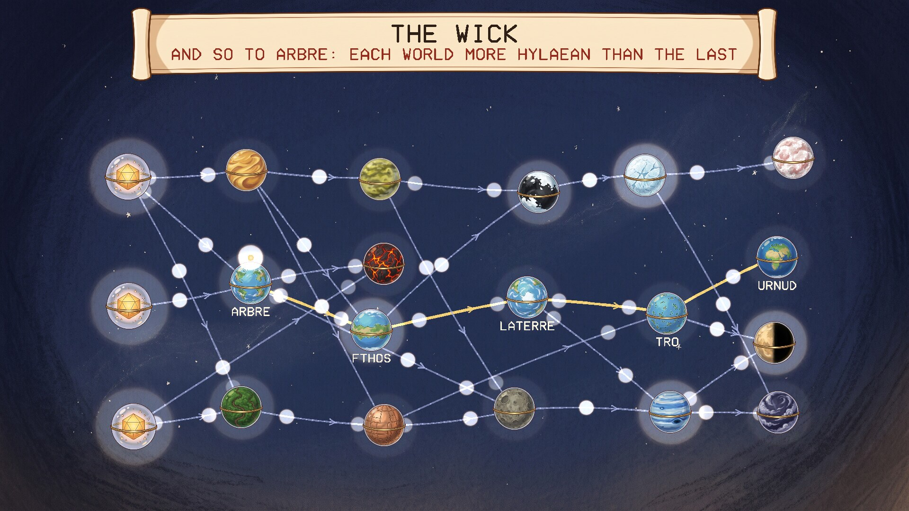
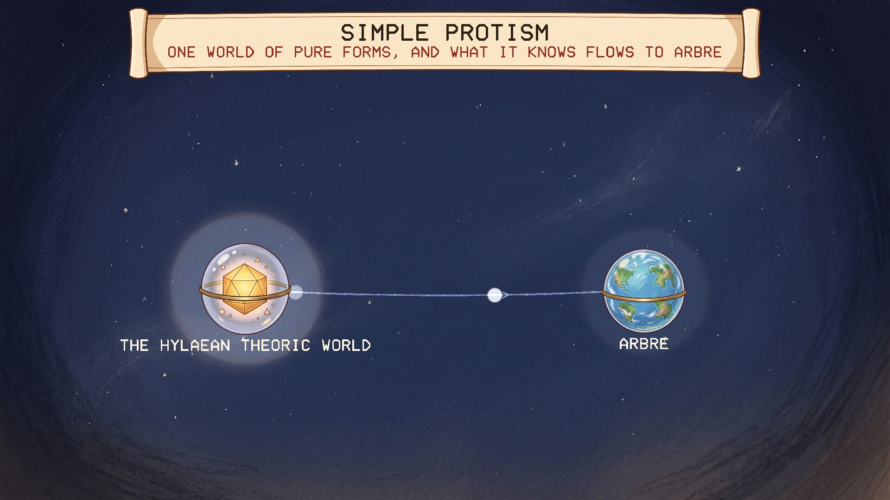
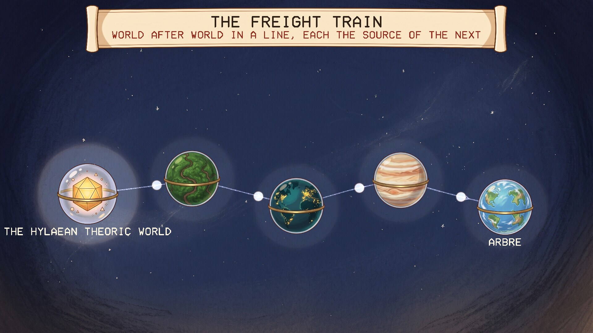
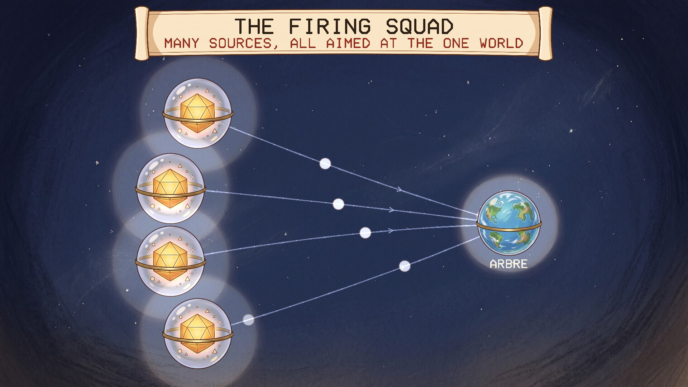
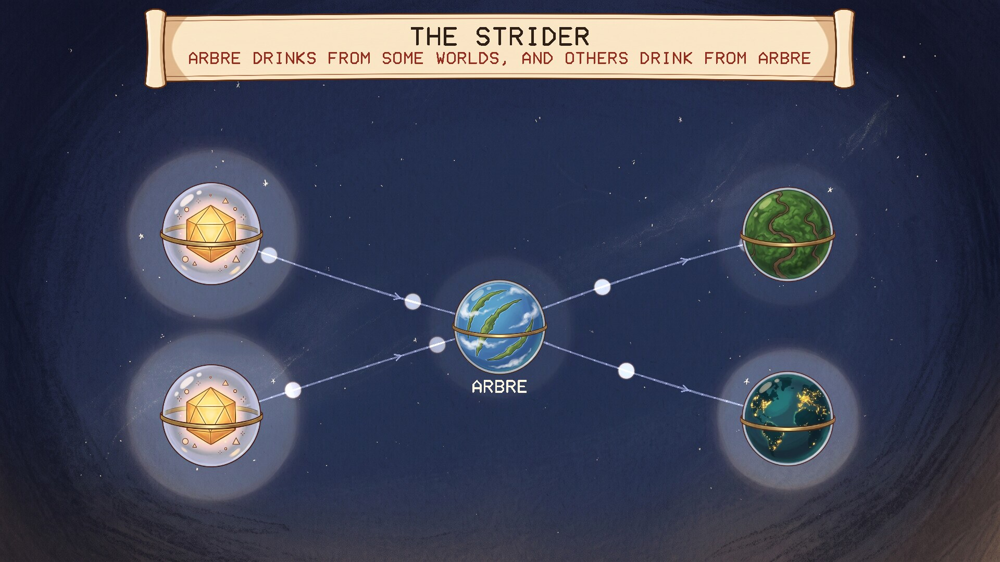

# The Wick

A screensaver of the Wick, from Calca 3 of Neal Stephenson's novel *Anathem*. Runs
on Linux, Windows and macOS. One of the [Anathem screensavers](https://github.com/mottipython/anathem-screensavers).

## The idea

Calca 3, "Complex versus Simplex Protism", is about where knowledge of pure forms
comes from. Simple Protism has one world of pure forms, the Hylaean Theoric World,
and what it knows flows to Arbre along one arrow. Complex Protism supposes many
worlds, joined so that knowledge flows from the more Hylaean to the less and never
comes round to where it started. The Calca builds up through diagrams with
nicknames to the general case, which is the Wick.

## What the screensaver shows

Each diagram is built out of worlds in glass, joined by threads, with sparks of
light running along every thread the way its arrow points.

| | |
|---|---|
|  |  |
| Simple Protism: one source, one arrow | The Freight Train: worlds in a line |
|  |  |
| The Firing Squad: many sources, one world | The Strider: Arbre between its sources and the worlds it feeds |

Then the Wick, a different one every time: worlds of pure forms on the left, and
rank after rank of worlds to the right, every thread running from an earlier rank
to a later one. No two of the nameless worlds look alike. Five worlds on it are named, and a spark climbs from one to the
next against the flow: Urnud, Tro, Laterre, Fthos, Arbre, the road of the Daban
Urnud. The four home worlds are drawn as they are painted on the ship, told apart
by their land: Urnud one great continent, Tro all islands, Laterre a continent at
its southern pole, Fthos a belt round its equator.

### What is from the book and what is mine

From the book: Simple and Complex Protism, the flow going one way only, the Wick as
the general case, the nicknames Freight Train, Firing Squad and Strider, and the
ship's road through those five worlds, and how the four home worlds' land lies.

Mine: the exact shape I have given each nicknamed diagram, which I drew from memory
and from a summary and not from the book's own figures; that the ship climbs
towards more Hylaean worlds; and worlds as planets in glass.

## Install

Packages are on the [releases page](../../releases).

### Windows

Run `Wick-Setup-1.0.2.exe`. It asks for administrator rights, because Windows
only lists screensavers that are in its own system folder. After that "The Wick" is in Screen Saver Settings with the others, already selected. Uninstall from
Apps.

### macOS

There are two downloads on the releases page, for Apple Silicon and Intel, macOS 11
or later.

**The screen saver** is the file ending `-mac-screensaver.zip`. Unzip it and
double-click the `.saver` file; macOS offers to install it. Then choose it in System
Settings, Screen Saver (scroll to the end of the list, under Other).

**The app** is the file ending `-mac.zip`: the same thing as an ordinary program
that runs full screen until you press a key.

Neither is signed with an Apple developer certificate, so macOS will refuse them at
first. After the refusal, open System Settings, Privacy & Security, scroll down,
and click Open Anyway. If the screen saver still will not load, clear the
quarantine mark in Terminal:

    xattr -dr com.apple.quarantine ~/Library/"Screen Savers"

Both are built on a Mac build machine, where the screen saver is loaded and made to
draw as a test. They have not yet been tried by a person on a real Mac, and screen
savers on recent macOS are known to be temperamental; reports are welcome.

### Linux

**Fedora, Nobara** (built on Fedora 44):

    sudo dnf install ./wick-1.0.2-1.fc44.x86_64.rpm

**Debian, Ubuntu, Mint** (Ubuntu 24.04 / Debian 13 or later):

    sudo apt install ./wick_1.0.2_amd64.deb

From your next login it starts by itself after five minutes idle, and any key or
mouse movement ends it. To start the watcher without logging out, or to change the
delay:

    wick-screensaver enable 10    # after 10 minutes idle
    wick-screensaver disable
    wick-screensaver status
    wick-screensaver now          # run it right away

Wayland desktops have no screensaver service to plug into, so the package starts a
small idle watcher (`swayidle`) at login. It works on compositors that provide the
ext-idle-notify protocol: KDE Plasma, Sway, Hyprland, niri, COSMIC, labwc and
others. GNOME does not provide it, and on X11 you would add `wick` to
xscreensaver or your desktop's own idle settings. It does not lock the screen. If
one of the other *Anathem* screensavers
([Teglon](https://github.com/mottipython/teglon),
[the Lazy Peregrin](https://github.com/mottipython/lazy-peregrin),
[Cutting the Cake](https://github.com/mottipython/cutting-the-cake),
[the Clock of Saunt Edhar](https://github.com/mottipython/edhar-clock),
[the Weed War](https://github.com/mottipython/weed-war),
[the Daban Urnud](https://github.com/mottipython/daban-urnud),
[the Adrakhonic Theorem](https://github.com/mottipython/adrakhonic),
[the Analemma](https://github.com/mottipython/analemma),
[Bolt, Chord and Sphere](https://github.com/mottipython/bolt-chord-sphere)) is already on screen it stays out of the way.

If [screensaver-service](https://github.com/mottipython/screensaver-service) is
installed, the Wick appears in its list of screen savers, and that service starts
it in place of the watcher described above.

## Running it yourself

    wick              full screen on every display; any key or mouse movement quits
    wick --window     in a window; Esc or Q quits
    wick --speed 2    faster
    wick --snapshot out.bmp --time 60 --size 1920x1080

## Building

Needs a C compiler, make and SDL2 (2.0.18 or newer). Build from the top of the
source tree, because the pictures in `assets/art` are built into the program.

    make
    make check
    sudo make install

Packages are written to `dist/`. `tools/Containerfile` describes a container with
everything they need:

    podman build -t anathem-build -f tools/Containerfile tools
    podman run --rm --security-opt label=disable -v "$PWD":/src -w /src anathem-build make dist

## Credits and licence

MIT. *Anathem* and the Wick are Neal Stephenson's; this is an unofficial fan
project.

The pictures (the worlds, the sky and the scroll) were drawn with Google Gemini and
prepared by `tools/make_sprites.py`. Images are decoded with
[stb_image](https://github.com/nothings/stb) (public domain).
